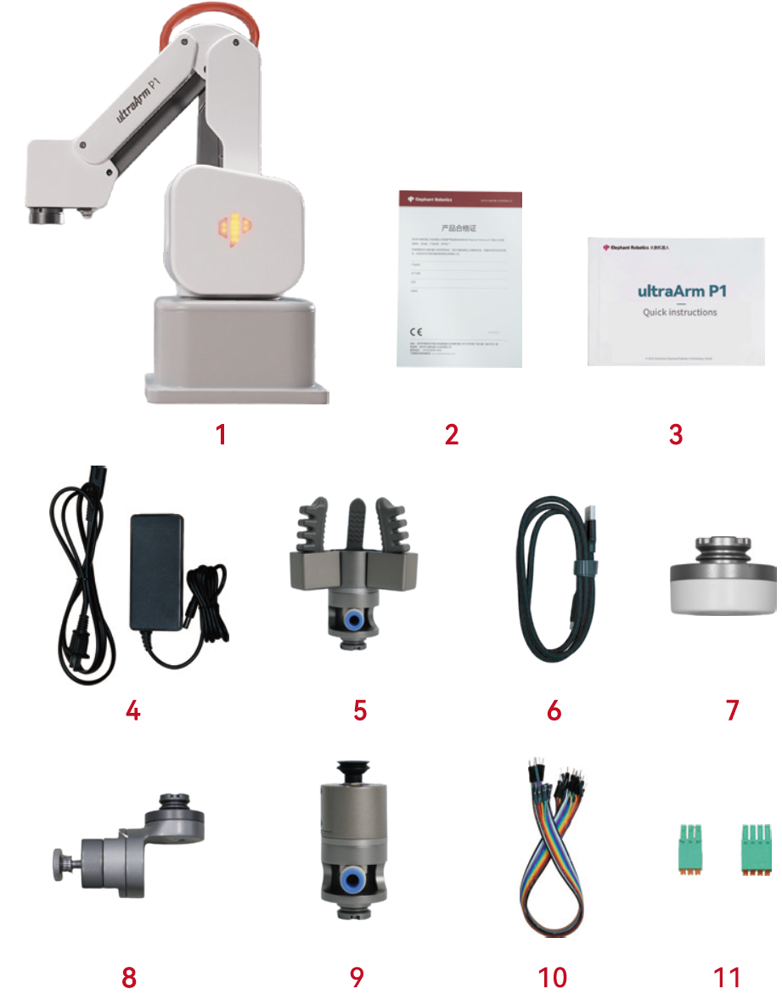

# Product Standard List

## 1. Product List Image
> Thank you for choosing the Elephant Robotics ultraArm P1 robotic arm. This chapter is designed to help you easily get started with Elephant Robotics products and enjoy every wonderful moment brought by the product.

## 2. Packing List

| No. | Name | Qty |
| :--: | :--- | :--: |
| 1 | ultraArm P1 Robotic Arm | 1 |
| 2 | Product Certificate | 1 |
| 3 | Product Brochure | 1 |
| 4 | DC 12V 8A Power Adapter | 1 |
| 5 | ultraArm Pneumatic Gripper | 1 |
| 6 | USB Cable | 1 |
| 7 | ultraArm Quick-Change Connector | 1 |
| 8 | ultraArm Pen Holder | 1 |
| 9 | ultraArm Vertical Suction Pump | 1 |
| 10 | Dupont Wires | 2 |
| 11 | 3-Pin, 4-Pin Quick-Connect Terminals | 1 |

**Note:** After the packing box arrives, please confirm that the robot packaging is intact. If there is any damage, please contact the logistics company and the supplier in your area in time. After unpacking, please check the actual items in the box according to the item list.

---

[← Previous Chapter](README.md) | [Next Chapter →](4.2-ProductUnboxingGuide.md)
